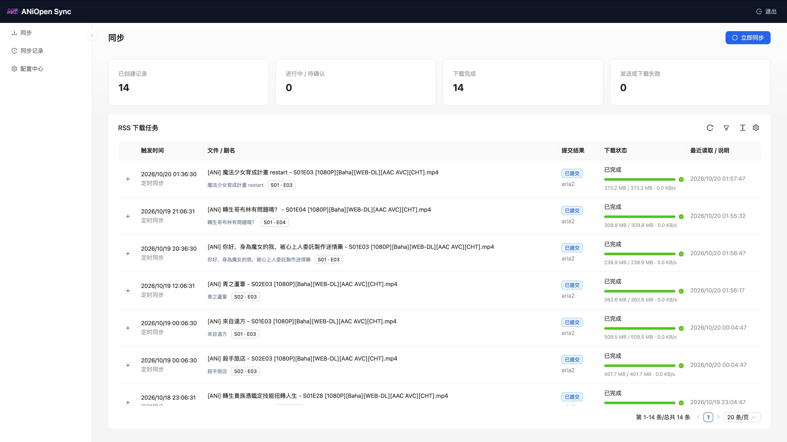

# ANiOpen Sync

[](https://github.com/ChowDPa02k/aniopen-sync/actions/workflows/ci.yml)

ANiOpen Sync 定时读取 ANi RSS，把新番剧集提交给 aria2 或 qBittorrent，并在网页中提供配置、手动同步和下载进度。解析器移植自 [Kubespider](https://github.com/opennaslab/kubespider)，保留其季集识别规则。



## 功能

- 支持 ANi 的直链 RSS 与 Torrent RSS。直链交给 aria2，Torrent 可使用 aria2 或 qBittorrent。
- 自动处理季号映射、集数偏移、关键词黑名单和 qBittorrent 分类、标签与子分类。
- 在线季集映射实时读取 [ani-tmdb-mapper](https://github.com/ChowDPa02k/ani-tmdb-mapper)，支持手动覆盖和离线缓存。
- 支持秒级 cron、固定间隔和单次执行三种调度方式，可设置时区。
- Web 界面包含**配置中心**、**同步**和**同步记录**三个页面，配置可用表单或 YAML 编辑，保存后立即生效。
- 通过下载器 API 只读跟踪任务进度，下载出错或跟踪中断后可继续观察。
- 可选的 aria2 HTTP 自动重试：失败后按退避间隔重建任务并继续跟踪，默认关闭。
- 去重记录、配置和历史持久化，自动备份，提供健康检查接口。

## 快速开始

需要 Docker Engine（或 Docker Desktop）与 Compose v2。ANiOpen Sync 使用 GHCR 公网镜像，支持 `linux/amd64` 和 `linux/arm64`，Docker 会自动选择主机架构。

创建部署目录，选择下方一种方案，将 YAML 保存为该目录中的 `compose.yaml`：

```sh
mkdir -p aniopen-sync
cd aniopen-sync
```

### 方案一：单独部署

适合连接已有的 aria2 或 qBittorrent。

```yaml
services:
  aniopen-sync:
    image: ${ANIOPEN_IMAGE:-ghcr.io/chowdpa02k/aniopen-sync:latest}
    restart: unless-stopped
    user: "${ANIOPEN_UID:-10001}:${ANIOPEN_GID:-10001}"
    stop_grace_period: 120s
    ports:
      - "${ANIOPEN_BIND_ADDRESS:-0.0.0.0}:${ANIOPEN_PORT:-8090}:8090"
    environment:
      TZ: ${TZ:-Asia/Shanghai}
      ANIOPEN_API_TOKEN: ${ANIOPEN_API_TOKEN:-}
      ANIOPEN_ALLOWED_HOSTS: ${ANIOPEN_ALLOWED_HOSTS:-}
    volumes:
      - aniopen-data:/data
    read_only: true
    tmpfs:
      - /tmp:rw,nosuid,noexec,size=32m
      - /run:rw,exec,nosuid,nodev,size=16m,mode=0700,uid=${ANIOPEN_UID:-10001},gid=${ANIOPEN_GID:-10001}
    cap_drop: [ALL]
    security_opt: [no-new-privileges:true]
    logging:
      driver: json-file
      options:
        max-size: "10m"
        max-file: "3"
volumes:
  aniopen-data:
```

### 方案二：与 aria2 一起部署

此方案同时启动 [SuperNG6 的 aria2 镜像](https://github.com/SuperNG6/docker-aria2) 和 ANiOpen Sync，两个服务通过 Compose 默认网络通信。aria2 的 RPC 仅在容器网络内使用，宿主机只开放 WebUI 的 8090 端口及 BT/DHT 的 32516 端口。

```yaml
services:
  aniopen-sync:
    image: ${ANIOPEN_IMAGE:-ghcr.io/chowdpa02k/aniopen-sync:latest}
    restart: unless-stopped
    user: "${ANIOPEN_UID:-10001}:${ANIOPEN_GID:-10001}"
    stop_grace_period: 120s
    ports:
      - "${ANIOPEN_BIND_ADDRESS:-0.0.0.0}:${ANIOPEN_PORT:-8090}:8090"
    environment:
      TZ: ${TZ:-Asia/Shanghai}
      ANIOPEN_API_TOKEN: ${ANIOPEN_API_TOKEN:-}
      ANIOPEN_ALLOWED_HOSTS: ${ANIOPEN_ALLOWED_HOSTS:-}
    volumes:
      - aniopen-data:/data
    read_only: true
    tmpfs:
      - /tmp:rw,nosuid,noexec,size=32m
      - /run:rw,exec,nosuid,nodev,size=16m,mode=0700,uid=${ANIOPEN_UID:-10001},gid=${ANIOPEN_GID:-10001}
    cap_drop: [ALL]
    security_opt: [no-new-privileges:true]
    logging:
      driver: json-file
      options:
        max-size: "10m"
        max-file: "3"
  aria2:
    image: superng6/aria2:latest
    restart: unless-stopped
    environment:
      PUID: ${ARIA2_UID:-1000}
      PGID: ${ARIA2_GID:-1000}
      TZ: ${TZ:-Asia/Shanghai}
      SECRET: ${ARIA2_SECRET:?Set ARIA2_SECRET in .env}
      PORT: "6800"
      BTPORT: "32516"
      WEBUI: "false"
      UT: "false"
      RUT: "true"
      SMD: "true"
      FA: falloc
      QUIET: "true"
    ports:
      - "32516:32516"
      - "32516:32516/udp"
    volumes:
      - ./aria2-config:/config
      - ./downloads:/downloads
    logging:
      driver: json-file
      options:
        max-size: "10m"
        max-file: "3"
volumes:
  aniopen-data:
```

在同一目录创建 `.env`，将 RPC 密钥替换为自己的随机字符串，并把 UID/GID 改为下载目录所有者的值。NAS 使用 `app` 用户时，可通过 `id app` 查询：

```dotenv
ARIA2_SECRET=replace-with-your-random-secret
ARIA2_UID=1000
ARIA2_GID=1000
```

aria2 的配置保存到 `./aria2-config`，下载文件保存到 `./downloads`。可将 `./downloads` 替换为 NAS 的媒体目录，容器内路径仍保留 `/downloads`。镜像的其它选项见 [SuperNG6 的使用说明](https://github.com/SuperNG6/docker-aria2#环境变量说明)。

### 启动与登录

在保存 `compose.yaml` 的目录执行：

```sh
docker compose pull
docker compose up -d --wait
docker compose exec aniopen-sync aniopen-sync token
```

打开 `http://服务器地址:8090`，本机部署可访问 <http://127.0.0.1:8090>，使用上述命令输出的访问令牌登录。

进入「配置中心」，填写下载器地址和凭据，确认保存路径、时区与调度规则。方案二使用以下配置：

| 配置项 | 值 |
| --- | --- |
| 订阅的下载器 | `aria2` |
| aria2 连接地址 | `http://aria2:6800/jsonrpc` |
| aria2 RPC 密钥 | `.env` 中的 `ARIA2_SECRET` |
| 下载根目录 | `/downloads` |
| 订阅保存路径 | `TV/ANi`，可按需修改 |

方案二的文件会保存到宿主机的 `./downloads/TV/ANi`。启用订阅并保存后，下一次同步会处理当前 RSS 中所有尚未见过的条目，也可点击「立即同步」。订阅默认关闭。

ANiOpen Sync 的配置、历史和访问令牌保存在 `aniopen-data` 数据卷中。`docker compose down` 保留数据卷；需要清空数据时才使用 `docker compose down -v`。

## 配置

主要配置项：

| 配置 | 说明 |
| --- | --- |
| `source.api_type` | `http`（直链）或 `torrent` |
| `source.rss_link` / `rss_link_torrent` | 两种订阅源对应的 RSS 地址 |
| `source.downloader` | 使用哪个下载器，对应 `downloaders` 中的名称 |
| `source.save_path` | 下载器内的相对保存路径，例如 `TV/ANi` |
| `source.blacklist` | 按标题关键词跳过条目 |
| `downloaders.*.endpoint` | 下载器连接地址 |
| `downloaders.*.download_base_path` | 下载器看到的根目录，例如 `/downloads` |
| `schedule` | 调度方式、时区、cron / interval / date 参数 |

默认调度为 `Asia/Shanghai` 时区每小时的第 6 分钟和第 36 分钟（30 秒）。完整字段和默认值见 [config/example.yaml](config/example.yaml)。

## 下载器连接

容器内的 `127.0.0.1` 指向服务自身，请按下载器的实际位置填写地址：

| 下载器位置 | 地址示例 |
| --- | --- |
| Docker 宿主机 | `http://host.docker.internal:6800/jsonrpc` |
| 同一 Docker 网络 | `http://aria2:6800/jsonrpc`、`http://qbittorrent:8080` |
| 其它机器或反向代理 | `http://192.0.2.10:6800/jsonrpc`、`https://downloads.example/qbit` |

Linux 上使用 `host.docker.internal` 时，需要在 Compose 中为服务添加：

```yaml
extra_hosts:
  - "host.docker.internal:host-gateway"
```

如果下载器已在某个 Docker 网络中运行，在现有 `compose.yaml` 中合并以下网络设置，将 `app-net` 替换为已有网络名：

```yaml
services:
  aniopen-sync:
    networks:
      - app-net
networks:
  app-net:
    external: true
```

aria2 填完整的 JSON-RPC 地址；qBittorrent 填 WebUI 根地址。`download_base_path` 是下载器看到的路径，媒体文件由下载器直接写入对应目录。

## 访问与安全

服务默认监听所有网卡的 8090 端口。除健康检查和登录页外，所有 API 都需要访问令牌，令牌保存在浏览器会话中；配置中的密码和密钥默认脱敏显示。

可以通过 `.env` 或环境变量调整部署：

| 变量 | 默认值 | 说明 |
| --- | --- | --- |
| `ANIOPEN_PORT` | `8090` | 宿主机端口 |
| `ANIOPEN_BIND_ADDRESS` | `0.0.0.0` | 监听地址，可设为 `127.0.0.1` 限制本机访问 |
| `ANIOPEN_API_TOKEN` | 自动生成 | 固定访问令牌 |
| `ANIOPEN_ALLOWED_HOSTS` | 空 | 允许的 Host，逗号分隔；使用自定义域名时必填 |
| `ANIOPEN_UID` / `ANIOPEN_GID` | `10001` | 容器运行用户 |
| `ANIOPEN_IMAGE` | `ghcr.io/chowdpa02k/aniopen-sync:latest` | 镜像地址，可指定标签或 digest 固定版本 |
| `TZ` | `Asia/Shanghai` | 容器时区 |

项目面向可信网络中的单管理员使用。通过公网访问时，建议在反向代理上启用 HTTPS，并妥善保管令牌。

## 运行维护

- **健康检查**：`/api/health` 返回进程状态，`/api/health/ready` 检查 RSS 与下载器连接。Docker 每 30 秒调用就绪接口，依赖故障时容器显示为 `unhealthy`，恢复后自动转回 `healthy`。
- **备份**：服务每 6 小时生成一次在线备份，默认保留 7 天，存放在 `/data/backups`。手动备份：

  ```sh
  docker compose exec aniopen-sync \
    aniopen-sync backup --output /data/backups/manual.tar.gz
  docker compose cp aniopen-sync:/data/backups/manual.tar.gz ./aniopen-backup.tar.gz
  ```

  备份包含下载器凭据，请保存到安全位置，并定期复制到其它存储或使用绑定挂载。
- **升级**：

  ```sh
  docker compose pull aniopen-sync
  docker compose up -d --no-deps aniopen-sync
  ```

  升级前先备份。上述命令只更新 ANiOpen Sync，联合部署中的 aria2 保持运行。数据库和配置会自动迁移。

- **日志**：Compose 默认轮转日志（单文件 10 MB，保留 3 份），可用 `docker compose logs -f aniopen-sync` 查看。

部署、恢复和故障排查的更多细节见 [docs/operations.md](docs/operations.md)。

## 开发

需要 Python 3.11+、Node.js 22.12+ 和 [uv](https://docs.astral.sh/uv/)。

```sh
uv sync --locked --extra dev
npm ci --prefix web
npm run build --prefix web
uv run aniopen-sync
```

本地默认访问 <http://127.0.0.1:8090>，数据目录为 `./data`，首次启动的令牌会打印在日志中。`ANIOPEN_DATA_DIR` 和 `ANIOPEN_WEB_DIR` 可以覆盖数据与前端目录。

运行检查与测试：

```sh
uv run ruff check aniopen_sync tests scripts
uv run pytest -q
npm test --prefix web
```

开发约定和测试说明见 [CONTRIBUTING.md](CONTRIBUTING.md)。

需要从本地源码构建容器时：

```sh
docker compose -f compose.yaml -f compose.build.yaml up -d --build
```

## 相关文档

- [部署、升级与恢复](docs/operations.md)
- [完整配置示例](config/example.yaml)
- [变更记录](CHANGELOG.md)
- [贡献指南](CONTRIBUTING.md)

## 许可与致谢

项目使用 [Apache-2.0](LICENSE) 许可。

ANi RSS 解析逻辑来源于 [opennaslab/kubespider](https://github.com/opennaslab/kubespider)，上游版本与修改说明见 [NOTICE](NOTICE)；在线季集映射由 [ChowDPa02k/ani-tmdb-mapper](https://github.com/ChowDPa02k/ani-tmdb-mapper) 提供。
